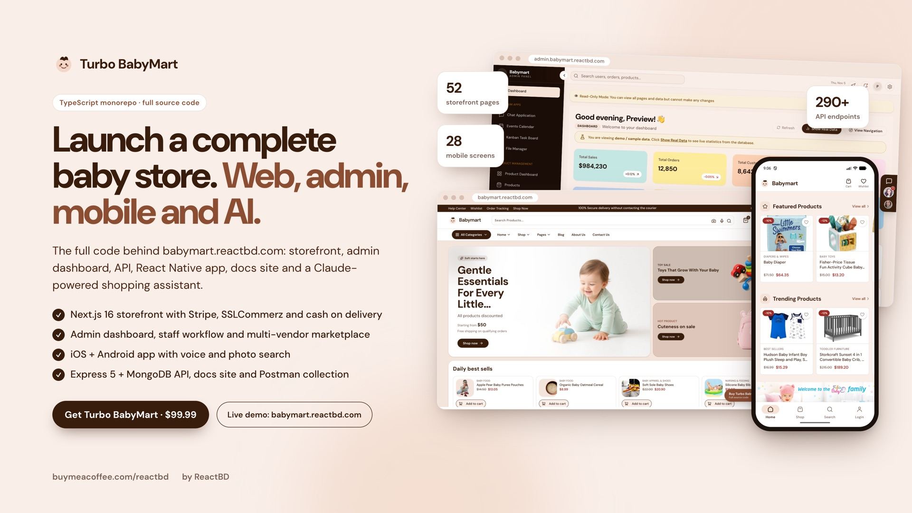
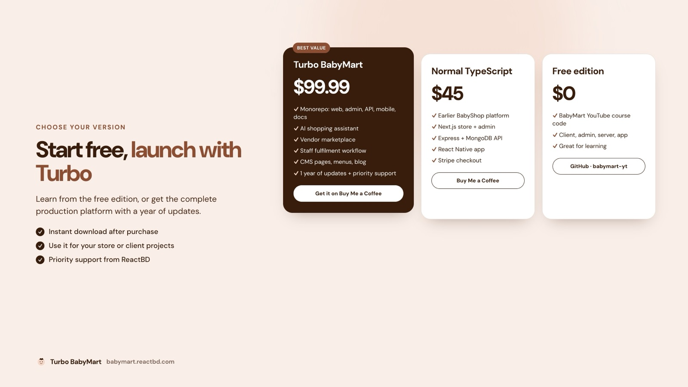

<div align="center">

# 🧸 BabyMart, free edition

**The free, open-source starter for BabyMart: the baby-products e-commerce platform built step by step on the [ReactBD YouTube channel](https://www.youtube.com/@reactjsBD).**

A Next.js storefront, a React admin dashboard, an Express + MongoDB API and a React Native app, in one repository and wired together, ready for you to build on.

[](https://babymart.reactbd.com)
[](https://admin.babymart.reactbd.com)
[](https://docs.babymart.reactbd.com)
[](https://buymeacoffee.com/reactbd/e/493505)

       



<sub>The banner and live demos show <b>Turbo BabyMart</b>, the complete platform this starter grows into.</sub>

</div>

---

## 📚 Contents

- [What this repository is](#-what-this-repository-is)
- [All the links](#-all-the-links)
- [What's inside](#-whats-inside)
- [Free, Normal or Turbo: which one do you need?](#-free-normal-or-turbo-which-one-do-you-need)
- [Quick start](#-quick-start)
- [Environment variables](#-environment-variables)
- [Project structure](#-project-structure)
- [Scripts](#-scripts)
- [Deployment](#-deployment)
- [Troubleshooting](#-troubleshooting)
- [Support and community](#-support-and-community)

---

## 🍼 What this repository is

This is the **starting point of the BabyMart course**. Every app is set up, configured and running, so you can follow the videos and build the store feature by feature:

- ✅ **Four apps, one repo:** storefront, admin, API and mobile app, each with its own `package.json`
- ✅ **Modern stack:** Next.js 15, React 19, Vite 7, Tailwind CSS 4, Express 5, Mongoose 8, React Native 0.80, TypeScript
- ✅ **API foundations ready:** a MongoDB connection helper, a JWT token helper, auth and error middleware, Cloudinary and email config, a Swagger spec and a health check, ready to wire into your routes
- ✅ **UI foundations ready:** Tailwind CSS 4 and shadcn/ui in the storefront and admin, with a starter screen in each app explaining what goes where
- ✅ **Free to learn from**, fork and experiment with

> [!TIP]
> Want the finished store instead of the starter? **[Turbo BabyMart](https://buymeacoffee.com/reactbd/e/493505)** is the complete production platform running at [babymart.reactbd.com](https://babymart.reactbd.com): checkout with Stripe, SSLCommerz and cash on delivery, a full admin, vendor marketplace, staff workflow, mobile app, docs site and an AI shopping assistant. [Compare the editions ↓](#-free-normal-or-turbo-which-one-do-you-need)

---

## 🔗 All the links

| What | Link |
|---|---|
| 🛍️ **Live storefront** | [babymart.reactbd.com](https://babymart.reactbd.com) |
| 🧑‍💼 **Live admin dashboard** (click **Master Admin** on the login page for read-only access) | [admin.babymart.reactbd.com](https://admin.babymart.reactbd.com) |
| 📖 **Documentation** | [docs.babymart.reactbd.com](https://docs.babymart.reactbd.com) |
| 🚀 **Turbo BabyMart**: full source code, $99.99 ($89.99 for members) | [buymeacoffee.com/reactbd/e/493505](https://buymeacoffee.com/reactbd/e/493505) |
| 📦 **Normal TypeScript edition**: $45 | [buymeacoffee.com/reactbd/e/432469](https://buymeacoffee.com/reactbd/e/432469) |
| 🎬 **YouTube course** | [youtube.com/@reactjsBD](https://www.youtube.com/@reactjsBD) |
| ⭐ **This free repo** | [github.com/noorjsdivs/babymart-yt](https://github.com/noorjsdivs/babymart-yt) |

---

## 🧩 What's inside

| App | Folder | Tech | Runs on | What you get in this repo |
|---|---|---|---|---|
| 🛍️ **Storefront** | [`client/`](client) | Next.js 15 (App Router), React 19, Tailwind CSS 4, shadcn/ui | `http://localhost:3000` | A styled home screen that lists what the store will have, the shadcn/ui setup and `.env` keys for the API and Stripe |
| 🧑‍💼 **Admin dashboard** | [`admin/`](admin) | React 19, Vite 7, Tailwind CSS 4, shadcn/ui | `http://localhost:5173` | A starter admin screen, the UI setup and the API URL wiring |
| ⚙️ **API server** | [`server/`](server) | Node.js, Express 5, Mongoose 8, JWT, Stripe, Cloudinary, Swagger | `http://localhost:8000` An info page at `/`, a `/health` check, helpers for MongoDB, JWT, Cloudinary and email, auth and error middleware, a Swagger spec and a Vercel config |
| 📱 **Mobile app** | [`mobileapp/`](mobileapp) | React Native 0.80 (CLI), React 19, TypeScript | iOS simulator / Android emulator | A themed starter screen that adapts to light and dark mode, ready for the shop screens |

---

## 💎 Free, Normal or Turbo: which one do you need?



| | 🆓 **Free** (this repo) | 📦 **Normal TypeScript** | 🚀 **Turbo BabyMart** |
|---|:---:|:---:|:---:|
| Price | **Free** | **$45** | **$99.99** |
| Best for | Learning with the course | A complete single-repo store | Launching a real business or client stores |
| Storefront | Starter screen | ✅ Full store | ✅ 52 pages, Next.js 16, SEO, CMS pages |
| Admin dashboard | Starter screen | ✅ | ✅ Catalog, orders, invoices, users, purchases, salaries, content, analytics |
| API | Foundations | ✅ | ✅ 290+ endpoints, 31 models, tests |
| Mobile app | Starter screen | ✅ React Native | ✅ React Native 0.88, 28 screens, voice and photo search |
| Payments | — | Stripe | Stripe, SSLCommerz (bKash, Nagad) and cash on delivery |
| Vendor marketplace | — | — | ✅ |
| Staff fulfilment workflow | — | — | ✅ Call centre → packer → rider → accounts |
| AI shopping assistant | — | — | ✅ Claude-powered |
| Docs site and Postman collection | — | — | ✅ |
| Updates and support | Community | Email support | 1 year of updates + priority support |
| Get it | You're here | [Buy ($45)](https://buymeacoffee.com/reactbd/e/432469) | [**Buy ($99.99)**](https://buymeacoffee.com/reactbd/e/493505) |

---

## 🚀 Quick start

### Prerequisites

- **Node.js 20.19 or newer** and **npm**
- **MongoDB**: a free [MongoDB Atlas](https://www.mongodb.com/atlas) cluster or a local install
- **Cloudinary** account for images: [cloudinary.com](https://cloudinary.com)
- **Stripe** account in test mode for payments: [dashboard.stripe.com](https://dashboard.stripe.com/test/apikeys)
- For the mobile app: the [React Native environment setup](https://reactnative.dev/docs/set-up-your-environment) (Xcode for iOS, Android Studio for Android)

### 1. Clone

```bash
git clone https://github.com/noorjsdivs/babymart-yt.git
cd babymart-yt
```

### 2. API server (`server/`)

```bash
cd server
npm install
# Fill in server/.env (see "Environment variables" below)
npm run dev        # http://localhost:8000
```

Open `http://localhost:8000` for the server info page and `http://localhost:8000/health` for a health check. The MongoDB helper (`config/db.js`) and the Swagger spec (`config/swagger.js`) are ready to connect as you build the API in the course.

### 3. Storefront (`client/`)

```bash
cd client
npm install
npm run dev        # http://localhost:3000
```

### 4. Admin dashboard (`admin/`)

```bash
cd admin
npm install
npm run dev        # http://localhost:5173
```

### 5. Mobile app (`mobileapp/`)

```bash
cd mobileapp
npm install
npm start          # starts Metro
npm run android    # in a second terminal, or: npm run ios
```

> [!NOTE]
> On iOS, install the native pods once first: `cd mobileapp/ios && bundle install && bundle exec pod install`.

---

## 🔐 Environment variables

Each app ships its own `.env` with the keys and **no secret values**. Fill them in locally and never commit real keys.

<details open>
<summary><b><code>server/.env</code></b></summary>

| Key | Required | What it is |
|---|:---:|---|
| `PORT` | ✅ | Port for the API, `8000` by default |
| `MONGO_URI` | for the database | MongoDB connection string, from [MongoDB Atlas](https://www.mongodb.com/atlas) → Connect |
| `JWT_SECRET` | for auth | Long random string used to sign login tokens |
| `STRIPE_SECRET_KEY` | for payments | Stripe secret key (`sk_test_…`), from [Stripe API keys](https://dashboard.stripe.com/test/apikeys) |
| `STRIPE_WEBHOOK_SECRET` | for payments | Webhook signing secret (`whsec_…`), from `stripe listen` or [Stripe webhooks](https://dashboard.stripe.com/test/webhooks) |
| `CLOUDINARY_CLOUD_NAME`, `CLOUDINARY_API_KEY`, `CLOUDINARY_API_SECRET` | for uploads | From the [Cloudinary console](https://console.cloudinary.com) |
| `ADMIN_URL`, `CLIENT_URL` | ✅ | Allowed front-end origins (CORS), e.g. `http://localhost:5173` and `http://localhost:3000` |
| `PRODUCTION_SERVER_URL` | in production | The public URL of the deployed API |

</details>

<details>
<summary><b><code>client/.env</code></b></summary>

| Key | Required | What it is |
|---|:---:|---|
| `API_ENDPOINT`, `NEXT_PUBLIC_API_URL` | ✅ | API base URL, `http://localhost:8000` in development |
| `NEXT_PUBLIC_STRIPE_PUBLISHABLE_KEY` | for payments | Stripe publishable key (`pk_test_…`) |
| `STRIPE_SECRET_KEY`, `STRIPE_WEBHOOK_SECRET` | for payments | Same as the server's, used by Next.js route handlers |
| `NODE_ENV`, `NEXT_PUBLIC_APP_ENV` | — | `development` or `production` |

</details>

<details>
<summary><b><code>admin/.env</code></b></summary>

| Key | Required | What it is |
|---|:---:|---|
| `VITE_API_URL` | ✅ | API base URL, `http://localhost:8000` in development |
| `CLIENT_URL` | — | Storefront URL, used for links back to the shop |
| `VITE_APP_ENV` | — | `development` or `production` |

</details>

---

## 🗂️ Project structure

```text
babymart-yt/
├── client/        # 🛍️ Next.js 15 storefront   (src/app, src/components/ui, src/lib)
├── admin/         # 🧑‍💼 React + Vite admin       (src/App.tsx, src/components/ui, src/lib)
├── server/        # ⚙️ Express 5 API           (config/, middleware/, utils/, index.js, vercel.json)
│   ├── config/        db.js · cloudinary.js · swagger.js
│   ├── middleware/    authMiddleware.js · errorMiddleware.js
│   └── utils/         generateToken.js · emailService.js
└── mobileapp/     # 📱 React Native 0.80 app    (App.tsx, android/, ios/)
```

---

## 📜 Scripts

| App | Command | What it does |
|---|---|---|
| `server` | `npm run dev` | Start the API with auto-reload (nodemon) |
| `server` | `npm start` | Start the API for production |
| `client` | `npm run dev` / `npm run build` / `npm start` | Develop, build and serve the storefront |
| `client`, `admin` | `npm run lint` | Lint with ESLint |
| `admin` | `npm run dev` / `npm run build` / `npm run preview` | Develop, build and preview the admin |
| `mobileapp` | `npm start` / `npm run android` / `npm run ios` | Start Metro and run the app |
| `mobileapp` | `npm test` | Run the Jest tests |

---

## ☁️ Deployment

- **API:** `server/vercel.json` is included, so you can import the repo on [Vercel](https://vercel.com/new), set the root directory to `server` and add the environment variables. Any Node.js host works too.
- **Storefront:** deploy `client/` to Vercel (framework preset: Next.js).
- **Admin:** deploy `admin/` to Vercel (framework preset: Vite, output folder `dist`).
- **Database:** MongoDB Atlas. Allow your host's IP addresses under Network Access.
- **Mobile:** build release apps with Android Studio and Xcode, and point the app at your deployed API.

The full production setup, including Stripe webhooks, the go-live checklist and the mobile release steps, is covered in the [documentation](https://docs.babymart.reactbd.com).

---

## 🛠️ Troubleshooting

| Problem | Fix |
|---|---|
| `MongoServerError` / cannot connect | Check `MONGO_URI`, and allow your IP in Atlas → Network Access |
| CORS errors in the browser | Set `CLIENT_URL` and `ADMIN_URL` in `server/.env` to the exact front-end URLs |
| Port already in use | Change `PORT` in `server/.env`, or stop the other process |
| Android app can't reach the API | Use `http://10.0.2.2:8000` from the Android emulator instead of `localhost` |
| iOS build fails on pods | Run `bundle exec pod install` in `mobileapp/ios` again |

---

## 💬 Support and community

- 🎬 Watch the course: [youtube.com/@reactjsBD](https://www.youtube.com/@reactjsBD)
- 🐛 Found a bug in the starter? [Open an issue](https://github.com/noorjsdivs/babymart-yt/issues)
- ⭐ If this repo helps you, give it a star
- 🚀 Ready to launch? [Get Turbo BabyMart](https://buymeacoffee.com/reactbd/e/493505) and start from the finished platform

Follow along: [Facebook](https://www.facebook.com/Noorlalu143/) · [Instagram](https://www.instagram.com/simplenoor143/) · [LinkedIn](https://www.linkedin.com/in/noor-mohammad-ab2245193/) · [X](https://x.com/NoorMoh74531005)

<div align="center">

Made with ❤️ by **[Noor Mohammad](https://www.linkedin.com/in/noor-mohammad-ab2245193/)** · **ReactBD**

</div>
